

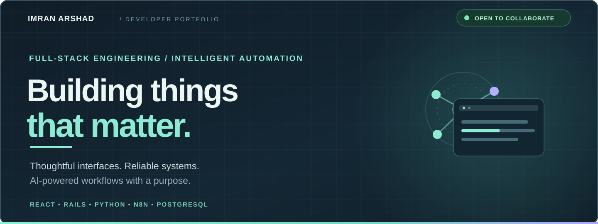

01 / THE INTRODUCTION
Hi, I'm Imran — a full-stack developer who enjoys building products that look polished, run reliably, and make complex things feel simple. My work combines React, Ruby on Rails, Python, PostgreSQL, and intelligent workflow automation.

I care about the details across the whole experience: responsive interfaces, clean backend architecture, useful integrations, and thoughtful AI agents.
My guiding principle: Make it beautiful to use, dependable to run, and genuinely useful.

02 / SKILLS & EXPERTISE

<table>
<tr>
<td width="50%">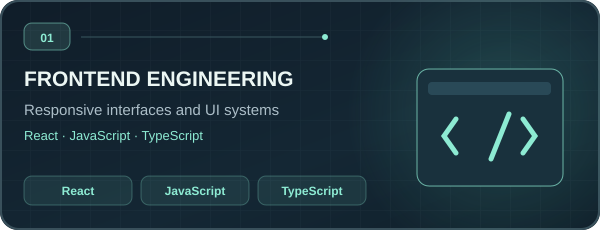</td>
<td width="50%">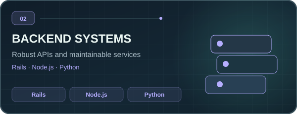</td>
</tr>
<tr>
<td width="50%">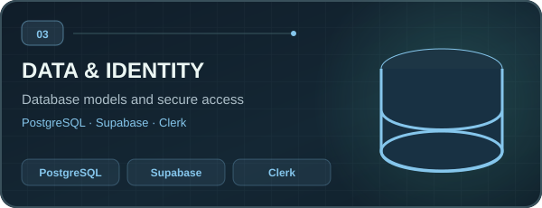</td>
<td width="50%">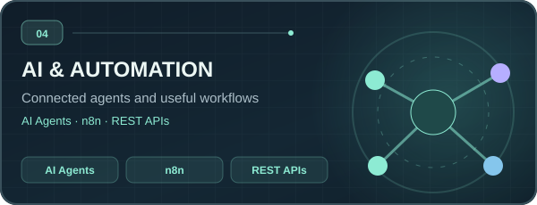</td>
</tr>
<tr>
<td width="50%">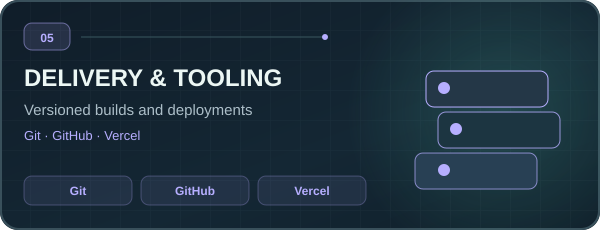</td>
<td width="50%">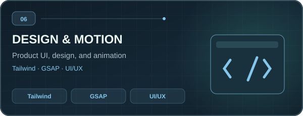</td>
</tr>
</table>

One connected workflow: <b>design → build → automate → ship.</b>

03 / SELECTED WORK
<table>
<tr>
<td width="50%" valign="top">
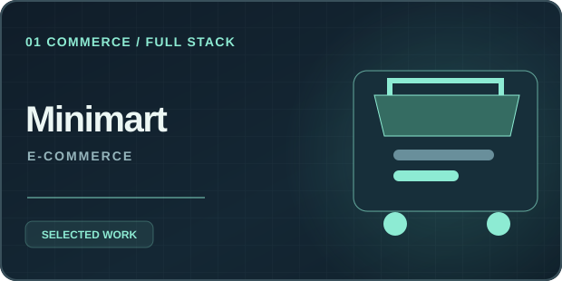
<h3>01 — Minimart E-Commerce</h3>

<b>The challenge:</b> Bring everyday shopping into one straightforward experience.

<b>The build:</b> Shopping cart, account authentication, and product flows.

<code>Rails</code> <code>JavaScript</code> <code>PostgreSQL</code>

</td>
<td width="50%" valign="top">
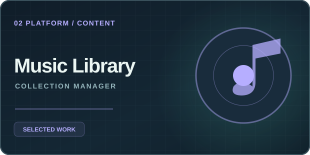
<h3>02 — Music Library App</h3>

<b>The challenge:</b> Keep music collections organized and manageable.

<b>The build:</b> Full CRUD operations for a structured music library.

<code>Rails</code> <code>JavaScript</code> <code>PostgreSQL</code>

</td>
</tr>
<tr>
<td width="50%" valign="top">
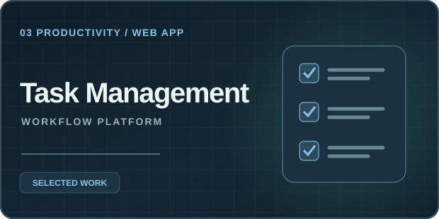
<h3>03 — Task Management</h3>

<b>The challenge:</b> Simplify day-to-day task organization.

<b>The build:</b> Login, prioritization, and responsive task workflows.

<code>Rails</code> <code>JavaScript</code> <code>MVC</code>

</td>
<td width="50%" valign="top">
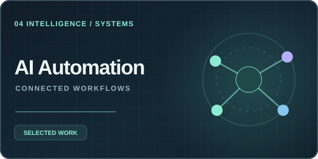
<h3>04 — AI Workflow Automation</h3>

<b>The challenge:</b> Reduce repeat work across connected services.

<b>The build:</b> Agents for planning, communication, and live information digests.

<code>n8n</code> <code>AI Agents</code> <code>REST APIs</code>

</td>
</tr>
</table>

<a href="https://github.com/ImranArshad?tab=repositories">Browse my repositories →</a>

04 / THE AUTOMATION LAB

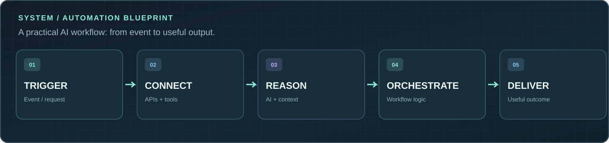

Automated solution	What it is built to do
Diet Plan Agent	Create structured meal-planning workflows.
Communication Agent	Connect email, WhatsApp, and chatbot workflows.
Weather & News Digest	Aggregate information from APIs into practical updates.

05 / GITHUB DEVELOPMENT PULSE

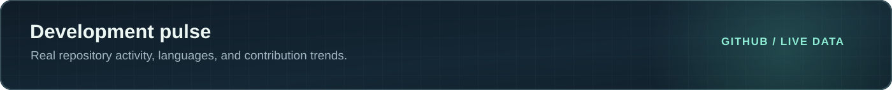

Stats reflect public GitHub data reported by third-party widgets; some charts may be rate-limited.

06 / THE GREEN CONTRIBUTION JOURNAL

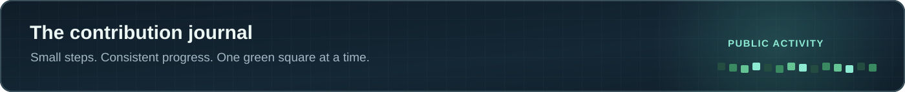

<picture>
  <source media="(prefers-color-scheme: dark)" srcset="https://raw.githubusercontent.com/ImranArshad/ImranArshad/output/snake-dark.svg" />
  <source media="(prefers-color-scheme: light)" srcset="https://raw.githubusercontent.com/ImranArshad/ImranArshad/output/snake-light.svg" />
  
</picture>

The snake appears after the included GitHub Actions workflow runs successfully. Contribution squares represent public GitHub activity, not only commits.

07 / HOW I BUILD
Principle	In practice
Design with intention	Thoughtful structure, responsive UI, and consistent visual language.
Engineer for reliability	Reusable components, clear APIs, and maintainable backend logic.
Make automation useful	Integrate agents and workflows where they save real effort.
Keep improving	Test, refine, simplify, and ship with care.

<a href="mailto:imranarshad10002@gmail.com">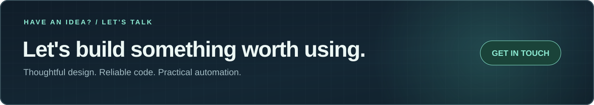</a>

Building intelligent products, one thoughtful detail at a time.

Open to full-stack, React, AI-agent and automation collaborations.

Made with intention · Engineered for the long term

