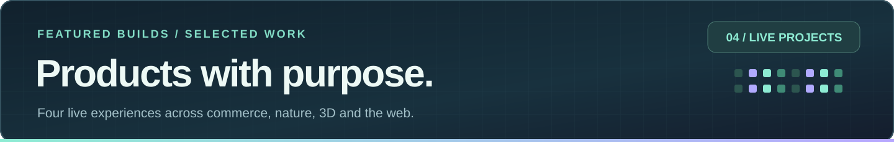
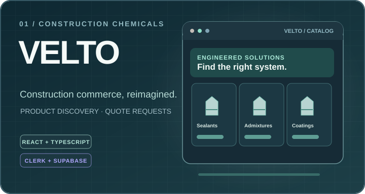
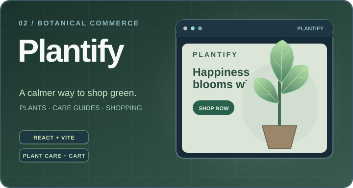
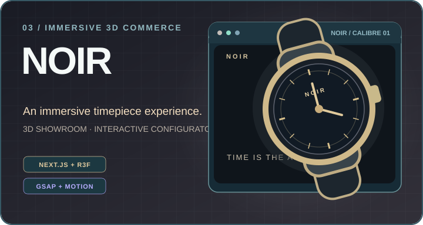
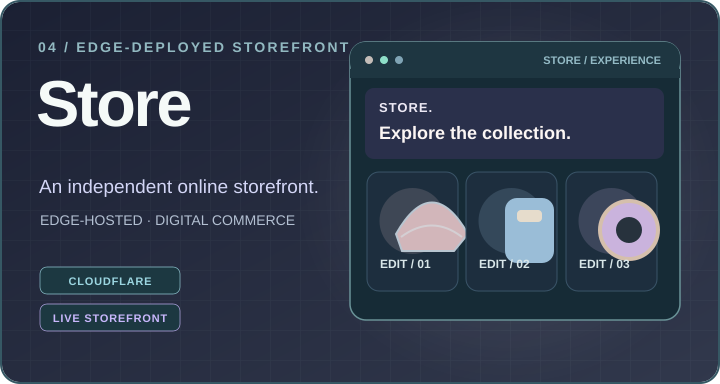
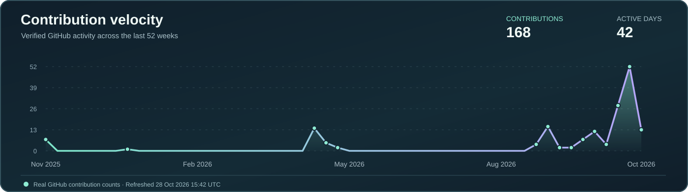

 

  

### 01 / THE INTRODUCTION

Hi, I'm **Imran** — a full-stack developer who enjoys building products that look polished, run reliably, and make complex things feel simple. My work combines **React, Ruby on Rails, Python, PostgreSQL, and intelligent workflow automation**.

I care about the details across the whole experience: responsive interfaces, clean backend architecture, useful integrations, and thoughtful AI agents.

> **My guiding principle:** Make it beautiful to use, dependable to run, and genuinely useful.

 

### 02 / SKILLS & EXPERTISE

<table>
<tr><td width="50%"></td><td width="50%"></td></tr>
<tr><td width="50%"></td><td width="50%"></td></tr>
<tr><td width="50%"></td><td width="50%"></td></tr>
</table>
One connected workflow: <b>design → build → automate → ship.</b>

 

### 03 / SELECTED WORK

<table>
<tr>
<td width="50%" valign="top">

<h3>01 / VELTO — Construction Commerce</h3>

A product-focused <b>construction chemicals storefront</b> with searchable product discovery, detailed catalogue pages, multi-product quote requests, customer accounts and a staff admin area.

<code>React</code> <code>TypeScript</code> <code>Vite</code> <code>Clerk</code> <code>Supabase</code>

<a href="https://velto-dusky.vercel.app/"><b>↗ Live Website</b></a> &nbsp; · &nbsp; <a href="https://github.com/imranarshad3/Velto">Source Code</a>

</td>
<td width="50%" valign="top">

<h3>02 / PLANTIFY — Botanical Storefront</h3>

A polished <b>plant-shopping experience</b> featuring curated plant collections, product details, fertilizer browsing, care guides, search, a shopping cart and account flows.

<code>React</code> <code>Vite</code> <code>React Router</code> <code>Clerk</code>

<a href="https://plantify-2lp0gcx3r-imarnarshad10002s-projects.vercel.app/"><b>↗ Live Website</b></a> &nbsp; · &nbsp; <a href="https://github.com/imranarshad3/Plantify">Source Code</a>

</td>
</tr>
<tr>
<td width="50%" valign="top">

<h3>03 / NOIR — Immersive 3D Experience</h3>

A cinematic <b>luxury watch storefront</b> combining a scroll-driven 3D watch, interactive product configurator, responsive showroom and shopping bag with accessible fallback states.

<code>Next.js</code> <code>TypeScript</code> <code>R3F / Three.js</code> <code>GSAP</code> <code>Motion</code>

<a href="https://inoir.netlify.app/"><b>↗ Explore Live Experience</b></a>

</td>
<td width="50%" valign="top">

<h3>04 / STORE — Cloud Storefront</h3>

An independently deployed <b>online storefront experience</b> on a Cloudflare Workers domain. Explore the live site for its shopping interface and overall product presentation.

<code>Online Store</code> <code>Cloudflare Workers</code> <code>Live Deployment</code>

<a href="https://store.inoonmr.workers.dev/"><b>↗ Visit Live Website</b></a>

</td>
</tr>
</table>

These illustrations are custom portfolio visuals, not screenshots of the deployed websites.

<a href="https://github.com/imranarshad3?tab=repositories"><b>More work on GitHub →</b></a>

 

### 04 / THE AUTOMATION LAB

| Automated solution | What it is built to do |
|:---|:---|
| **Diet Plan Agent** | Generate structured meal-planning workflows. |
| **Communication Agent** | Connect email, WhatsApp, and chatbot processes. |
| **Weather & News Digest** | Gather API information into practical updates. |

 

### 05 / GITHUB DEVELOPMENT PULSE

Public GitHub data supplied by third-party chart services; availability and rate limits vary.

 

### 06 / THE GREEN CONTRIBUTION JOURNAL

<picture>
  <source media="(prefers-color-scheme: dark)" srcset="https://raw.githubusercontent.com/imranarshad3/imranarshad3/output/snake-dark.svg"/>
  <source media="(prefers-color-scheme: light)" srcset="https://raw.githubusercontent.com/imranarshad3/imranarshad3/output/snake-light.svg"/>
  
</picture>

The contribution snake appears after the GitHub Action completes. Contribution squares include more than commits alone.

 

### 07 / HOW I BUILD

| Principle | In practice |
|:---|:---|
| **Design with intention** | Thoughtful structure, responsive UI, consistent visual language. |
| **Engineer for reliability** | Reusable components, clear APIs, maintainable backend systems. |
| **Make automation useful** | Integrate AI agents and workflows where they save effort. |
| **Keep improving** | Test, refine, simplify, and ship with care. |

 

Building intelligent products, one thoughtful detail at a time.

Open to **full-stack, React, AI-agent, and automation** collaborations.

Made with intention · Engineered for the long term

